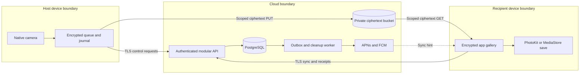

# 02 — Technical Architecture

Status: proposed, pending approval. Date: 27 October 2026. No services have been provisioned.

## Approach and stack decisions

| Area | Recommendation | Alternatives and trade-offs |
| --- | --- | --- |
| iOS | Swift, SwiftUI, AVFoundation, PhotoKit, URLSession, SQLite journal | UIKit only for camera bridging or proven gaps. Flutter/React Native reduce shared UI work but still require native camera, storage and lifecycle expertise; bridge risk conflicts with camera-first priorities |
| Android | Kotlin, Compose, CameraX, Room, WorkManager | Camera2 only for a measured CameraX gap; more manual control brings device quirks and lifecycle burden. Kotlin Multiplatform may share protocol models later; avoid shared camera abstractions initially |
| Server | TypeScript on supported Node.js LTS, Fastify modular monolith plus worker from the same codebase | Go offers efficient concurrency but no decisive MVP benefit; serverless lowers idle compute but adds job/runtime constraints. No microservices initially |
| State | Managed PostgreSQL, transactions, SQL migrations, outbox | Firestore accelerates realtime prototypes but complicates relational authorization and invariants. SQLite is local only |
| Media | Private AWS S3 bucket, client encryption plus server-side encryption | S3-compatible providers may reduce egress; compatibility, checksums, conditional writes and deletion semantics require contract testing. Use actual S3 first for predictable semantics |
| Identity | Apple and Google sign-in on both platforms via supported native/web flows; backend token verification | Managed auth reduces operations but adds cost and vendor dependencies; custom passwords add recovery and security work without product benefit |
| Push | Direct APNs for iOS, FCM for Android | FCM can proxy APNs but adds another iOS integration dependency. Push is only a sync hint |
| Hosting | One regional managed container service, managed Postgres, scheduled worker, secret manager | A single VM is cheaper but adds patching and failover responsibility. Select concrete region/provider only after residency and budget approval |

Use current stable SDK/toolchain versions when implementation is approved; do not pin guessed versions in a planning document. Proposed minimums: iOS 18 and Android 10/API 29, subject to M0 device coverage. Minimum OS and store target API are different decisions.

## Components and trust boundaries

The cloud sees identities, session membership, timing, sizes and routing; it does not receive content keys. Host camera plaintext necessarily exists before encryption. Recipient export creates an OS-managed plaintext copy outside app revocation.

## Mobile structure

Use presentation → application use cases → domain state → native adapters. Keep camera session configuration off the UI thread and serialized. Capture, crypto, transfer and library-save adapters have independent persistent states. Swift concurrency and Kotlin coroutines coordinate work; concurrency does not replace a durable journal.

Local tables: session snapshots/leases, photo manifests, transfer attempts and OS task IDs, recipient encrypted gallery, library-export intents/asset references, sync cursors, tombstones. Commit state before scheduling work; reconcile file and journal after interrupted commits. Write to private staging, atomically rename complete files, then journal Prepared. Backup exclusions apply to private photo files, wrapped keys and session material; test platform restore behavior. Keys live in Keychain/Android Keystore-backed protection, not preferences.

## Logical database schema

All IDs are opaque random identifiers; timestamps are server UTC. Foreign keys and scoped unique constraints are mandatory. This is a logical schema, not SQL implementation.

| Table | Key fields and invariants |
| --- | --- |
| users | id, normalized_username unique, display_name, status, deletion_requested_at |
| identities | provider, provider_subject unique together, user_id; never merge by email alone |
| devices | id, user_id, key IDs/public keys, key_version, status, registered_at, revoked_at |
| refresh_sessions | id, device_id, token_hash, family_id, expires_at, consumed_at; rotate and detect reuse |
| pairing_invites | id, issuer_device_id, nonce_hash, expires_at, consumed_at; one use, atomic consumption |
| sharing_sessions | id, host_device_id, recipient_device_id, key_fingerprints, permissions_version, approval timestamps, lease_expires_at, status, ended_at |
| photos | id, session_id, host_sequence, recipient_device_id, state, object_attempt_id, ciphertext_hash, bytes, reserved_at, expires_at, receipt_at; unique(session_id, host_sequence) |
| upload_attempts | id, photo_id, immutable_object_key unique, expected_hash/bytes, authorization_expires_at, verification_state; never reuse a committed object key |
| receipts | photo_id, recipient_device_id, kind, receipt_nonce, manifest_hash, received_at; unique(photo_id, device_id, kind) |
| outbox | id, event_type, aggregate_id, payload_without_secrets, available_at, attempts, completed_at |
| blocks_reports | actor_id, subject_id/session_id, reason, created_at, disposition; no photo upload to support by default |
| audit_events | pseudonymous actor/device IDs, action, result, timestamp; minimal security record |
| deletion_jobs | subject/resource IDs, due_at, state, attempts, verified_at; durable retry |

Keep raw EXIF, image thumbnails and plaintext content hashes out of the server DB. Encrypted manifests carry image metadata. Server hash covers ciphertext. Index recipient pending photos, expiry and outbox availability. Enforce exactly one active host session with a database constraint/transactional lock; transfers may outlive it.

## Identity and session protocol

Validate provider signature, issuer, audience, expiry and nonce on the server; use OAuth state and PKCE where the chosen flow supports/requires it. Apple sign-in on Android uses a browser/service-ID flow, not an assumed native Android Apple SDK. Use Google Credential Manager on Android rather than starting with legacy Google Sign-In integration. Account-linking requires fresh proof of both identities. Native Apple and Google sign-in on iOS support the same account backend. Platform flow references: [Google Credential Manager](https://developer.android.com/identity/sign-in/credential-manager-siwg-implementation), [Apple on other platforms](https://developer.apple.com/documentation/signinwithapple/incorporating-sign-in-with-apple-into-other-platforms).

Issue short-lived access tokens (proposed 10 minutes) and rotating refresh tokens (30-day inactivity expiry); store only refresh hashes. Revoke refresh families on reuse. Each registered device proves possession of its signing key when submitting approvals, receipts and sensitive actions. Apple/Google identity is account control, not real-world identity verification.

Pairing invitations contain a random 256-bit capability, issuer role, expiry and recipient public-key fingerprint; no email or bearer login token. Proposed expiry two minutes. Exact username requests are throttled and expire in five minutes. Both approvals bind session ID, roles, device IDs, permission version, expiry and key fingerprints. QR comparison or a short authentication string authenticates the device keys out of band. The recommended baseline requires first-session verification-code comparison for username pairing. Skipping that comparison would provide only trust-on-first-use with key-change warnings; this weaker alternative is not approved and must not be marketed as resisting an actively malicious key-directory server.

Session end stops new photo reservations. Already-reserved photos may finish uploading and obtain fresh short-lived upload grants until their absolute media expiry, even after ordinary session end. Cancellation or device/account revocation blocks new grants. An unreserved offline photo needs a separately signed recovery authorization from both original devices, referencing its unchanged original photo/session/recipient/key tuple; it is not reassigned to a new session. Recovery cannot extend the original local retention deadline; the new cloud deadline is the earlier of that deadline and reservation +72 hours. See [03](03-privacy-security.md) for races and leases.

## Transfer and synchronization contracts

Control API operations: create/consume invitation, request/approve/end session, reserve photo, authorize upload attempt, commit upload, list recipient changes, authorize download, submit received/export receipts, cancel photo, revoke device, request deletion. Every mutation uses a stable idempotency key scoped to principal and operation; mismatched reuse returns conflict. Authorization checks the authenticated user, device, session role and photo ownership on every operation. IDs alone never authorize access.

1. Reserve photo under an active session; bind recipient/key and set absolute expiry. Issue a narrowly scoped upload grant for one random attempt key, exact expected length/checksum and a proposed 15-minute lifetime.
2. Upload ciphertext directly. A retry after expiry requests a new attempt; committed objects are immutable. Validate size and SHA-256 checksum using supported storage checksums and server verification. An ETag is not treated as a universal content hash.
3. Commit records only verified objects; photo-ready plus outbox notification is one DB transaction. Notification failure cannot lose the pending photo.
4. Recipient requests cursor-based changes; downloads under a five-minute read grant, verifies encrypted manifest and AEAD, stores encrypted local bytes, then acknowledges durable receipt. The recipient keeps its own encrypted gallery copy independently of system-library permissions. On cursor expiry use a bounded complete inventory including tombstones. Foreground sync is authoritative; periodic bounded polling is sufficient for MVP, no WebSocket dependency.
5. Receipt triggers cleanup. Library-export receipt is independent. See [06](06-photo-lifecycle-reliability.md) for exact state semantics.

Uploads use single-object PUT for bounded still images; retry whole objects initially. Cap at 40 MB per photo and validate before reservation. Multipart transport is deferred unless M0 measurements justify it; any future multipart path requires abort cleanup and an authenticated framing format. Background URLSession uploads must be file-backed. Apple notes that user force-quit prevents automatic relaunch; Android schedulers are likewise constrained by user/system state. [Apple background session](https://developer.apple.com/documentation/foundation/urlsessionconfiguration/background(withidentifier:)), [Android transfer options](https://developer.android.com/develop/background-work/background-tasks/data-transfer-options).

## Operations and infrastructure

One primary region, separate staging/production accounts, private DB networking, TLS, least-privilege workload roles, private storage and block-public-access settings. Secrets and signing keys use a managed secret service. No public CDN for photos. Only API workers can issue grants; only cleanup roles delete. Infrastructure-as-code, migrations, CI and deployment pipelines belong to the approved development phase.

Use DB outbox polling with transactional claims and expiring worker leases; retries must be safe. Scheduled expiry scans every five minutes plus storage lifecycle backstop. Reconcile orphan upload attempts, missing objects and unfinished deletion jobs daily. Maintain a separate durable deletion/revocation journal in an independently protected control-record object store (not the temporary media bucket), retaining minimal IDs, action, event time and generation for 30 days. Persist each cancellation, account/device revocation and deletion intent there before acknowledging it; incomplete dual writes remain fail-closed and reconcile idempotently. Restore DB backups into isolation, replay the current journal and recompute absolute expiries before reopening grants. If the current journal cannot be verified, keep grant issuance disabled. The DB outbox alone is not sufficient evidence after rollback. Propose 14-day encrypted DB backup retention; media bucket has no replication/versioning/backups initially.

Capture privacy-safe counters and latency histograms per pipeline stage, OS/model family and app version; use opaque trace IDs. Alert on unauthorized grant attempts, oldest pending photo, receipt latency, duplicate exports, missing verified objects, cleanup lag and cost anomalies. Proposed cleanup target: p99 object removal ≤15 minutes after receipt/expiry; alert at 30 minutes. API deny rules take effect before physical deletion completes. Logs 14 days, minimal audit/tombstones 30 days unless approved legal requirements differ. Media expiry is independent of log retention.

Deploy gradually with backward-compatible protocol versions and additive DB migrations. Rollback disables new sessions while allowing safe pending delivery. Camera kill switches disable broken optional modes, never encryption or authorization. Establish on-call ownership, incident playbooks and restore drills before public release.

## Cost model and scaling triggers

At 30,000 photos/day ×5 MB: 150 GB/day ingress; one delivery per photo implies about 4.5 TB/month egress before retries. A full 72-hour undelivered backlog is about 450 GB. At an illustrative egress rate of $0.09/GB, media egress alone would be $405/month; this is arithmetic, not a current vendor quote. Add storage, requests, compute, managed DB, backups, logs, support, taxes and retry amplification. Budget approval needs selected-region pricing and beta measurements. Cap photos/account/day (proposed 300), concurrent transfers (2/device), bytes/account/day and request rates; provide clear quota errors.

Scale the monolith horizontally before splitting services. Consider a managed queue when DB job polling measurably impacts API latency, and alternative storage when egress dominates cost. Do not add Redis, Kubernetes, event streaming or global multi-region state without evidence.

Sources: [Google server token verification](https://developers.google.com/identity/sign-in/android/backend-auth), [S3 signed grants and checksum support](https://docs.aws.amazon.com/AmazonS3/latest/userguide/using-presigned-url.html), [S3 lifecycle semantics](https://docs.aws.amazon.com/AmazonS3/latest/userguide/lifecycle-expire-general-considerations.html). Capabilities require contract tests against the selected storage provider.
