# 06 — Photo Lifecycle & Reliability

Status: proposed protocol and failure policy. Date: 27 October 2026.

## Reliability contract

Capture → Processing → Encryption → Upload → Verification → Delivery → Local Save → Confirmation → Cloud Cleanup.

“Captured” is not yet durable; “Uploaded” is not delivered; “Received” is not saved to the system library. Each boundary needs a persisted state and evidence. Promise retry and recovery while at least one valid copy/key exists inside the retention window; finite retention, lost devices and OS restrictions prevent an unconditional no-loss guarantee.

The **durable recipient app copy** is the delivery acknowledgment boundary. System-library export is a second operation, not a reason to retain cloud media indefinitely. This choice enables cloud cleanup even if Photos permission is denied. Recipient UI must clearly distinguish the two outcomes.

## State model

```mermaid
stateDiagram-v2
  [*] --> Capturing
  Capturing --> Preparing: Capture callback with photo data
  Preparing --> HostPrepared: Encrypted file and local journal committed
  HostPrepared --> Reserved: Server authorizes immutable recipient and attempt
  Reserved --> Uploading
  Uploading --> CloudVerified: Checksum and length verified; commit accepted
  CloudVerified --> Downloading: Recipient obtains authorized grant
  Downloading --> RecipientStored: AEAD verified; encrypted file and journal committed
  RecipientStored --> ReceiptAccepted: Authenticated durable receipt
  ReceiptAccepted --> CloudCleanupPending
  CloudCleanupPending --> CloudRemoved
  RecipientStored --> ExportPending
  ExportPending --> LibrarySaved: OS save succeeded and local status committed
  ExportPending --> ExportUncertain: OS/local commit boundary interrupted
  ExportUncertain --> LibrarySaved: Existing asset safely reconciled
  ExportUncertain --> UserActionRequired: Cannot prove prior result
  HostPrepared --> Expired: Local deadline reached
  Reserved --> Expired: Server deadline reached
  CloudVerified --> Expired: No receipt before deadline
  Downloading --> Expired: Not durably stored before deadline
```

Recoverable failures add an error/retry marker to their current state rather than incorrectly advancing. Cancellation and corruption can terminate any applicable undelivered stage. Export is an independent branch after RecipientStored; it is not blocked by the server accepting the receipt. Retain terminal tombstones long enough to prevent stale sync from resurrecting items.

## Stage-by-stage evidence and recovery

| Stage | Required evidence before advancing | Recovery |
| --- | --- | --- |
| Capture | OS returns valid photo data with stable photo ID allocated before shutter request | Interrupted exposure may be lost; never show Prepared without durable bytes |
| Processing | Final supported encoded format, metadata allowlist, actual dimensions and size validated | Explicit failure and retry capture; do not send preview/proxy as original |
| Encryption | Fresh key/nonce, authenticated context, complete ciphertext in private staging | Atomic file rename; recover journal/files; remove incomplete plaintext as soon as possible |
| HostPrepared | Complete encrypted file plus recoverable journal and local key wrapper | Resume on foreground/scheduler; journal scan reconciles orphan files |
| Reservation | Session active, both approvals, immutable recipient/key, server photo ID and deadline | Stable idempotency key; if session already ended, do not silently send unreserved photos |
| Upload | Transfer task ID, object attempt key, immutable bytes, retry record | Resume OS task where supported or retry same bytes; expired grant gets new attempt |
| Verification | Server independently validates object existence, exact size and ciphertext checksum and accepts commit | Never rely on client success or storage event alone; retry commit after lost response |
| Delivery | Recipient downloads, checks manifest/signature/AEAD and writes durable encrypted app record | Retry download; quarantine/reject invalid ciphertext; no library save before verification |
| Local save | OS PhotoKit/MediaStore write finishes; local asset reference/status recorded where possible | Keep app copy on permission/storage error; treat interrupted save as potentially ambiguous |
| Confirmation | Recipient receipt authenticated and bound to photo ID/manifest/registered device | Retry receipt independently of export; lost acknowledgment does not redownload duplicate |
| Cloud cleanup | Logical grants denied; object/envelope deletion job completed and verified | Idempotent worker retries and expiry backstop; monitor lag |

Prefer processing in memory or private protected staging; background upload uses a ciphertext file. A capture callback followed by a crash before HostPrepared can lose that photo. Communicate this boundary with distinct preparing/queued feedback rather than claiming durability at shutter animation.

## Ordering, deduplication and integrity

Assign random photo ID plus monotonically increasing host sequence per session. A retry keeps photo ID and immutable canonical ciphertext; a new physical capture gets a new ID even if the image looks identical. Unique server and local constraints reject duplicate photo records. Use SHA-256 over ciphertext for storage verification and AEAD for content authenticity; no perceptual-image deduplication.

Use append-only stage timestamps and monotonic state versions. Transactions update state and outbox together. Cursor sync includes changes and tombstones; a repeated event is safe. Server receipt conflicts or unexpected recipient IDs are security failures, not blind retry candidates. Device restart may repeat work, never change recipient.

**Exactly-once app delivery:** practical via stable IDs and local constraints. **Exactly-once system-library export:** cannot be universally guaranteed across a crash between OS asset commit and app journal commit. On Android, use a stable app-owned URI/name and IS_PENDING, recover unfinished owned entries and reconcile before creating another. On iOS, journal export intent and any available placeholder/local asset reference; add-only access may not permit sufficient readback to prove the save. Attempt safe platform reconciliation; otherwise enter ExportUncertain, keep the app copy and require explicit user action. Do not request broad library access merely to hide this limitation. [PhotoKit add-only](https://developer.apple.com/documentation/photos/phaccesslevel), [Android shared-media ownership and pending writes](https://developer.android.com/training/data-storage/shared/media).

MediaStore publishing occurs only on the recipient. iOS add-only permission is sufficient for the proposed export path; the in-app gallery uses its own encrypted data rather than reading the entire photo library. Android 10+ supports creating app-owned shared media without broad read access; validate on target/minimum versions.

## Background execution and synchronization

On iOS, queue file-backed transfers using a background URLSession and persist task IDs. Reattach to the same session identifier after process recreation, move temporary downloads promptly into protected durable storage and reconcile tasks with the journal. OS completion does not grant unlimited time for decryption or library export; persist progress and resume later if necessary. File/key accessibility after lock or reboot must be tested, not assumed.

On Android, use unique WorkManager work for durable deferrable sync and retries. Evaluate user-initiated transfer jobs on supported versions only for genuinely user-triggered long work; incoming background messages are not blanket permission to start unrestricted foreground work. Observe foreground service permissions, visible notifications, quotas and current OS rules if such a service is justified. Do not poll continuously or start a hidden service to bypass restrictions. [Android transfer options](https://developer.android.com/develop/background-work/background-tasks/data-transfer-options), [user-initiated transfer rules](https://developer.android.com/develop/background-work/background-tasks/uidt).

APNs/FCM notifications are hints. Delayed, collapsed, duplicate or missing pushes are normal; sync on launch, foreground, eligible scheduled work and authenticated user retry. Apple does not guarantee background push delivery; an FCM acceptance ID is not a device receipt. [Apple background notifications](https://developer.apple.com/documentation/usernotifications/pushing-background-updates-to-your-app), [FCM message lifespan](https://firebase.google.com/docs/cloud-messaging/customize-messages/setting-message-lifespan).

Distinguish normal backgrounding, OS process termination, iOS user force-quit, Android force-stop and reboot. No promise that push wakes a force-stopped app. After reboot, expect key accessibility and scheduling delays; resume on unlock/foreground as supported. Never label a photo delivered because a push was sent.

## Failure matrix

| Failure | Required behavior |
| --- | --- |
| Network switches mid-upload | Keep encrypted queue; retry/reattach without allocating new photo; stale attempt cannot replace a committed object |
| Upload succeeds, API commit fails | Reconcile same attempt; verify object and commit idempotently; no premature Received label |
| Commit succeeds, response lost | Return previous result for same mutation key; do not upload a second canonical object |
| Recipient absent for days | Cloud retains only until absolute deadline; show pending and expiry, with best-effort warnings |
| Recipient app killed during download | Retain journal; verify resumed/completed file before decrypt; restart safe when resume unsupported |
| Recipient receipt response lost | Reissue same receipt; local photo remains unique; server cleanup stays idempotent |
| Host crash/restart | Reconcile encrypted files, local keys, journal and OS tasks; before-first-unlock work waits |
| Photos permission denied/revoked | Received app copy persists; user can grant permission/retry later; no false Saved state |
| Host insufficient storage | Stop accepting shutter when preflight cannot reserve safe space; protect existing queue; no silent eviction |
| Recipient insufficient storage | Do not receipt until app copy durable; leave pending in cloud within TTL; display actionable state |
| Storage fills after preflight | Handle actual write failure, clean partial files and keep source copy; preflight is advisory |
| Ciphertext/hash/AEAD mismatch | No library write; retry known-good download once; persistent mismatch alerts incident tooling |
| Expired grant | Obtain fresh grant only if still authorized and before absolute expiry |
| Session ends while uploading | Already reserved photos may obtain fresh grants and finish until absolute TTL after ordinary end; cancellation/revocation blocks new grants; unreserved captures need explicit recovery consent |
| Cancellation races with receipt | Server transaction orders cancellation/receipt; downloaded copies cannot be recalled; disclose outcome |
| Uninstall/lost keys | Local unsaved copies may be lost; no escrow recovery promise; cloud photo remains bound to original device key |
| Server outage | Queue locally within cap and lease; retry with backoff; no overwrite, route change or indefinite retention extension |

## Retry, backpressure and deadlines

Propose full-jitter exponential retry beginning around two seconds and capped at 15 minutes; honor Retry-After. Network/5xx retry; refresh authentication once for expired credentials, then prompt if needed. Authorization denial, expiry, unsupported format and cryptographic failure require distinct handling. Limit to two simultaneous transfers per device; prioritize oldest pending item and receipt/cleanup before new bulk work.

Host cap is 100 pending photos or 1 GB. Reserve headroom for one maximum-sized photo, encryption staging and the journal; encrypted preparation may temporarily require multiple copies. Recipient download headroom includes ciphertext, decrypt/export staging and OS-save copies; estimate conservatively at three times expected photo bytes plus a tested fixed safety margin. Never delete the only durable copy to free space.

Cloud access deadline = server reservation +72 hours; retries and offline time never reset it. Host local deadline = capture +72 hours. A photo that cannot reserve before session expiry is not silently uploaded later: retain encrypted locally within its deadline, show “Needs a new approved session,” and require a separate bilateral signed recovery authorization bound to the unchanged original photo ID, session ID, sender device, recipient device and key fingerprints, or explicit discard. The authorization references the old encrypted context; it does not move the photo into a new session. Reauthorization cannot extend the local 72-hour deadline; cloud expiry for recovered media is the earlier of that original deadline and reservation +72 hours. If an original device/key is unavailable, recovery is unsupported.

After CloudVerified, host may delete local ciphertext/key wrapper; its review becomes unavailable for that photo. After RecipientStored, receipt allows cloud deletion even if library save fails. A download that has not reached a verified durable local commit by the absolute deadline must be stopped and its incomplete data discarded. Recipient-local Received means the verified copy was committed before expiry; server-confirmed delivery additionally requires the authenticated receipt. A receipt may arrive late after an on-time local commit: accept it idempotently, record its late arrival separately and do not resurrect cloud data or issue new grants. The recipient keeps its valid local copy. Cross-device timing cannot be perfectly proven against a malicious recipient; this is a compliant-client lifecycle rule, not remote control of previously downloaded bytes.

Warn at 24 and 12 hours remaining, where execution/notification permission permits; display remaining time whenever the app opens. At expiry, deny grants immediately and queue deletion. Worker removal target is p99 ≤15 minutes, alert after 30 minutes; lifecycle rules are a safety net. An offline host cannot run cleanup until it executes again; disclose encrypted residual storage. No indefinite retention simply because receiving failed.

## Acceptance and failure-injection evidence

Before release, run at least 10,000 prepared photos across all four platform directions, with randomized failure injection at every state boundary. Include 100 repetitions each of commit-response loss, receipt-response loss, kill during library save, session-end/upload race and cancel/receipt race. Separately test natural capture-to-Prepared interruption and report its unavoidable exposure window.

Require zero unauthorized/wrong-recipient delivery, zero corruption accepted as valid, zero duplicate app records, zero false system-save success, and zero silent loss of a prepared photo while a valid retained source/key exists. Every queued photo must reconcile to delivered, canceled, expired or actionable failure. Ambiguous OS-save cases must enter ExportUncertain rather than claiming exactly once. Record system-library duplicates separately and block release on unbounded automatic duplication.

Test actual force-quit/force-stop, locked device, reboot-before-unlock, battery saver, Android OEM restriction, disabled notification permission, 72-hour recipient absence and simulated cleanup outage. Accelerated-clock tests supplement a real 72-hour soak; they do not replace it. Restore a DB backup with deleted photo records and revoked accounts/devices; replay the independent current deletion/revocation journal and verify no renewed grants. Simulate journal unavailability and require grant issuance to remain disabled. Measure the PRD service and delivery targets with explicit eligibility/exclusion counts.
